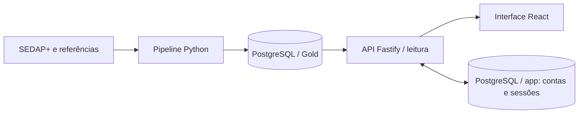
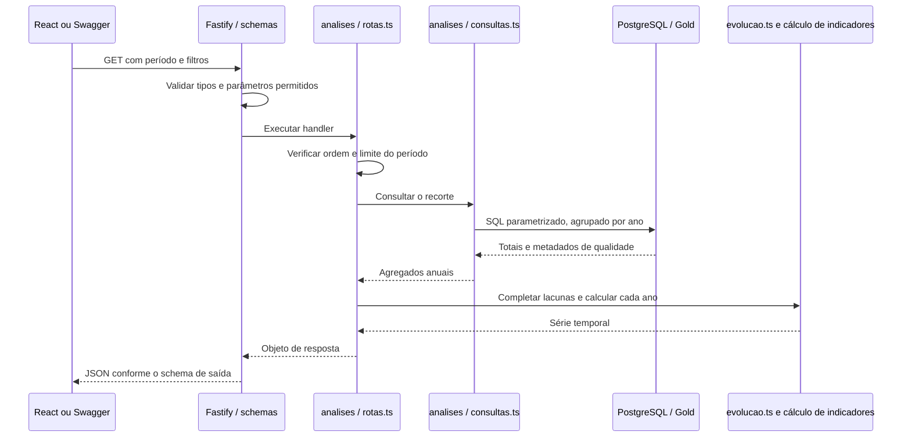

# Arquitetura da aplicação

A aplicação é um monorepo com dois pacotes: `frontend` (React/Vite) e `backend` (Fastify). O backend é um monólito modular: os módulos compartilham o mesmo processo e banco, mas cada um possui suas rotas, consultas e contratos. A pipeline Python tem repositório e execução independentes.

No frontend, Bootstrap 5.3 fornece estilos de formulários, botões, grade responsiva e tabela; Recharts apresenta as séries temporais. O CSS do Bootstrap é importado no ponto de entrada e complementado pelo tema em `styles.css`. React mantém o controle dos componentes e eventos. Veja [Estilização do frontend](FRONTEND_ESTILIZACAO.md) para a organização e os limites dessa integração.

## Arquitetura adotada no backend

**Monólito modular, organizado por funcionalidade, com separação entre HTTP, acesso a dados e regras de negócio e injeção de dependências manual.** Essa é a descrição da implementação atual.

O termo **monólito** significa que todos os módulos do backend são executados por uma única aplicação Fastify e são compilados e implantados juntos. Catálogos, indicadores e análises compartilham um pool de leitura da Gold. Autenticação usa um segundo pool no mesmo PostgreSQL, com credenciais restritas ao schema `app`. Não existe um servidor independente para cada módulo.

O termo **modular** significa que o código está dividido por responsabilidades do negócio. Cada módulo concentra suas rotas, contratos, consultas e regras específicas, expondo uma entrada pública em `index.ts`. Uma mudança na evolução temporal, por exemplo, começa em `modules/analises`, sem precisar reunir arquivos espalhados em pastas globais de controllers, services e repositories.

**Monorepo** descreve outra decisão: frontend e backend ficam no mesmo repositório e workspace pnpm. Isso não transforma o React em um módulo interno do backend. A comunicação entre eles continua sendo HTTP/JSON; no modo compilado, o Fastify também entrega os arquivos estáticos da interface.

Essa organização atende ao estágio atual do TCC: permite desenvolver, testar e executar o sistema como uma aplicação única, mantendo limites claros para novas funcionalidades. A pipeline é um sistema externo, com seu próprio repositório e ciclo de execução; sua separação não faz dos módulos da API microsserviços.

### Relação com outros estilos de arquitetura

O projeto **não implementa integralmente Clean Architecture nem arquitetura hexagonal**. Existem funções de cálculo independentes do framework e do banco, mas não há uma estrutura completa de entidades, casos de uso, portas e adaptadores. As consultas usam `pg` diretamente, e as rotas coordenam a consulta e o processamento do resultado.

Também não há camadas obrigatórias de classes `Controller`, `Service` e `Repository`. `rotas.ts` cumpre a função de entrada e coordenação HTTP; `consultas.ts` concentra a leitura do banco; funções específicas executam as regras. Essa separação pode evoluir quando um fluxo concreto precisar de coordenação mais complexa, sem adicionar camadas vazias antecipadamente.



## Execução

Em desenvolvimento, `pnpm dev` inicia Fastify na porta 3000 e Vite na 5173. O navegador usa caminhos relativos; o Vite encaminha `/api`, `/health` e `/docs` ao backend. Em `pnpm build` seguido de `pnpm start`, o Fastify serve também os arquivos compilados do React. `NODE_ENV=production` desativa o Swagger.

`pnpm dev:demo` prepara um PostgreSQL separado na porta 55433, carrega as fixtures e inicia os dois pacotes usando um login de leitura. Cada execução recria a Gold sintética desse container. O comando não altera o `.env` nem prepara o banco da pipeline.

`pnpm dev:demo:auth` acrescenta a preparação de `app` usando as mesmas migrações e grants do backend e provisiona o administrador se ausente. Preserva contas e permissões ao repetir a preparação. Inicia os servidores com autenticação habilitada e origem `http://127.0.0.1:5173`; o segredo JWT é gerado em memória a cada execução. `pnpm db:demo:auth` faz a preparação sem iniciar os servidores. O banco temporário e as credenciais técnicas de demonstração são exclusivos do projeto Docker `tcc-demo`.

## Limites de responsabilidade

- A pipeline extrai, transforma e grava dados; a API não executa essas etapas.
- A API valida os parâmetros, agrega medidas em SQL e calcula taxas sobre os totais.
- O frontend consulta HTTP/JSON e formata os resultados. Não importa código do backend, não acessa o PostgreSQL e não recalcula taxas.
- Cada módulo do backend expõe um `index.ts`. A composição da aplicação usa essas entradas; módulos não importam arquivos internos uns dos outros.
- `plugins/` reúne acesso compartilhado à Gold, saúde, proteção HTTP e logs. `config/` valida o ambiente. Os pools e seu encerramento são coordenados em `server.ts`.
- O backend mantém migrações próprias somente de `app`, executadas por comando de manutenção. A pipeline não cria contas administrativas; a API não migra as camadas analíticas.

## Módulos existentes

| Módulo         | Responsabilidade                                                   | Entrada HTTP                             |
| -------------- | ------------------------------------------------------------------ | ---------------------------------------- |
| `catalogos`    | Listar opções disponíveis para filtros                             | `GET /api/v1/filtros`                    |
| `indicadores`  | Agregar um recorte anual e calcular seus totais, taxas e qualidade | `GET /api/v1/indicadores/resumo`         |
| `analises`     | Consultar a série anual de um recorte, preservando lacunas         | `GET /api/v1/analises/evolucao-temporal` |
| `autenticacao` | Autenticar, renovar/revogar sessões e aplicar permissões           | `/api/v1/autenticacao/*`                 |

Saúde da aplicação, tratamento de erros e documentação da API são recursos transversais. `GET /health` pertence a `plugins/health.ts`; não é uma responsabilidade do módulo de indicadores. O controle de acesso é instalado na raiz do Fastify pelo módulo de autenticação, antes das rotas, conforme o [modelo de acesso](AUTORIZACAO.md).

## Organização do backend

```text
backend/src/
  modules/
    catalogos/       Opções disponíveis para filtros
    indicadores/    Resumo, agregações e taxas
    analises/       Evolução temporal por ano e recorte
    autenticacao/   Login, JWT, sessões e permissões
  database/         Migrações de app e provisionamento por CLI
  plugins/
    gold.ts         Junções da Gold e tratamento de falhas de consulta
    health.ts       Verificação de acesso às tabelas utilizadas
    erros.ts        Schema público de erro
  config/
    index.ts        Leitura e validação de variáveis de ambiente
  app.ts            Composição dos plugins e tratamento HTTP de erros
  frontend.ts       Serviço de arquivos estáticos e navegação da SPA
  server.ts         Pools, inicialização e encerramento do processo
```

O fragmento SQL em `plugins/gold.ts` define as junções comuns com a fato e as seis dimensões consumidas. Os módulos continuam responsáveis por suas seleções, filtros e agregações. Alterações nesse fragmento afetam catálogo, resumo, evolução temporal e saúde e devem passar pelos testes de integração.

Apesar do nome da pasta, nem todo arquivo em `plugins/` é um plugin registrável do Fastify. `health.ts` exporta um plugin; `gold.ts` e `erros.ts` fornecem funções, fragmentos SQL e schemas compartilhados. O tratamento global de erros é registrado em `app.ts`.

## Organização dentro de um módulo

| Arquivo                        | Responsabilidade                                            | Exemplo atual                                                       |
| ------------------------------ | ----------------------------------------------------------- | ------------------------------------------------------------------- |
| `index.ts`                     | Expor o plugin e o contrato público do módulo               | Exporta `analises` e `criarConsultasAnalises`                       |
| `rotas.ts`                     | Declarar endpoints, associar schemas e coordenar a execução | Verifica o intervalo, consulta os dados e monta a resposta temporal |
| `schemas.ts`                   | Definir contratos JSON Schema                               | Validação dos parâmetros e schema de serialização da resposta       |
| `consultas.ts`                 | Montar e executar SQL parametrizado                         | Agrega as medidas por ano em uma consulta                           |
| `calculos.ts` ou `evolucao.ts` | Executar regras específicas em funções                      | Calcula taxas ou completa os anos sem registros                     |

Os arquivos são criados conforme a responsabilidade existente: catálogos não precisa de `calculos.ts`, pois apenas lista opções. As funções de cálculo não recebem `request`, `reply` ou um pool PostgreSQL; recebem valores e devolvem resultados.

Os schemas validam a entrada e orientam a serialização da saída pelo Fastify. Eles não demonstram que uma fórmula está correta: os cálculos são verificados em testes próprios. Regras relacionais, como a ordem e o tamanho máximo de um intervalo de anos, também são verificadas pela rota antes de consultar o banco.

## Caminho de uma requisição

Exemplo: `GET /api/v1/analises/evolucao-temporal?ano_inicial=2022&ano_final=2024&codigo_curso=001`.



O SQL faz as somas e identifica ausências; as funções de negócio calculam as taxas sobre esses totais. O frontend recebe proporções e apenas as formata para exibição. Um ano ausente permanece sem medidas, em vez de ganhar uma contagem zero.

Se os parâmetros forem inválidos, a consulta é rejeitada com `400`. Falhas de consulta tratadas por `consultarGold` produzem `503`, sem expor SQL ou credenciais. Erros internos não classificados são tratados com `500`. A configuração desses comportamentos fica em `app.ts` e nos helpers compartilhados, enquanto cada rota define seus contratos.

## Comunicação e dependências entre módulos

A composição em `app.ts` registra os módulos de consulta usando `app.register`. Seus hooks e configurações locais podem ter escopo próprio, herdando o contexto de seus pais. Autenticação instala o controle de acesso na raiz, para alcançar todas as rotas protegidas, e depois registra seus endpoints. O encapsulamento organiza a aplicação; não representa isolamento de processos nem substitui autorização.

Quando um módulo precisa reutilizar regras de outro, importa sua **entrada pública**:

```typescript
// Dentro de modules/analises: contrato público de indicadores.
import {
	calcularResumo,
	agregacaoSQL,
	parametrizarFiltros
} from '../indicadores/index.js'
```

`analises` depende explicitamente desse contrato de `indicadores`. As taxas, a identificação de medidas incompletas e os filtros permanecem consistentes entre resumo e série temporal. Os módulos não fazem chamadas HTTP uns aos outros: a reutilização ocorre por funções no mesmo processo.

O contrato compartilhado inclui fragmentos SQL e schemas, além de cálculos. Portanto, há um acoplamento deliberado à modelagem Gold e aos aliases das junções compartilhadas. Expor funções pelo `index.ts` torna essa dependência visível, mas não torna o módulo independente do banco.

Para manter os limites:

- Importações entre módulos passam por `index.ts`; os arquivos internos podem mudar sem obrigar consumidores a conhecê-los.
- Apenas operações necessárias são exportadas; `index.ts` não precisa expor todo o conteúdo da pasta.
- Regras específicas ficam no módulo responsável; helpers transversais não devem se tornar um depósito de regras sem dono.
- Dependências devem seguir uma direção: atualmente análises reutiliza indicadores, e indicadores não depende de análises. Evite ciclos.

Essas fronteiras são convenções de organização e revisão do código. Ainda não existe uma regra de lint que bloqueie automaticamente importações de arquivos internos entre módulos.

## Injeção de dependências manual

O ponto de composição da infraestrutura é `server.ts`. Ele lê a configuração, cria **um pool de leitura da Gold e um pool opcional de autenticação por processo**, constrói as consultas e entrega essas dependências a `buildApp`. O primeiro tem até cinco conexões; o segundo, três, com as credenciais `APP_POSTGRES_*`. Ambos usam o mesmo host, porta e banco. Em seguida, inicia a escuta HTTP e configura o encerramento dos pools. A credencial de migração não é usada pelo servidor.

Trecho simplificado da composição das consultas públicas, após a criação de `config` e `pool`:

```typescript
const app = await buildApp(
	{
		indicadores: criarConsultasIndicadores(pool),
		catalogos: criarConsultasCatalogos(pool),
		analises: criarConsultasAnalises(pool),
		health: criarHealth(pool)
	},
	{ docs: config.docs, logger: true }
)
```

As fábricas recebem o pool e devolvem objetos com operações como `resumo`, `filtros` e `evolucao`. `app.ts` distribui esses objetos aos plugins. As rotas usam as operações recebidas e não criam conexões por conta própria.

Isso é injeção de dependências manual: a aplicação recebe os recursos necessários como argumentos, sem usar um contêiner de DI. `buildApp` pode montar o servidor para testes sem abrir uma porta de rede ou criar um pool real.

## Como a arquitetura é testada

- **Regras de negócio:** testes chamam diretamente as funções com agregados sintéticos e verificam fórmulas, base zero, ausências, ruído e grupos pequenos.
- **Contrato HTTP:** testes constroem a aplicação com consultas substitutas e usam `app.inject` para verificar parâmetros, respostas, erros e documentação.
- **Integração:** testes conectam as fábricas de consulta a um PostgreSQL sintético e verificam SQL, grants, filtros e equivalência entre a série temporal e o resumo anual.

A integração também testa a recuperação após reconstrução da Gold e reaplicação das permissões. Essas verificações protegem as responsabilidades compartilhadas, mas não substituem a validação com dados reais nem constituem uma prova automática de todas as fronteiras arquiteturais.

## Evolução prevista

O módulo `analises` oferece a API de evolução temporal e utiliza o contrato público de indicadores para manter as mesmas regras de agregação e cálculo. No frontend, `modules/analises` consulta essa API e apresenta gráfico Recharts e tabela acessível; o painel de indicadores compõe sua entrada pública e compartilha os sete filtros de recorte. Apenas tipos públicos de indicadores são importados por análises. O intervalo temporal é independente do ano do resumo e as taxas não são recalculadas no cliente.

Comparações entre cursos e grupos institucionais são os próximos incrementos. A Gold atual não fornece nomes ou siglas de IES nem identificadores institucionais permanentes para comparação individual. Administração do ETL depende de um contrato externo para execuções e reprocessamentos. Autorização e monitoramento serão recursos transversais; ainda não estão implementados. Pastas vazias desses módulos não são criadas antecipadamente.

## Documentação relacionada

O [modelo de autorização](AUTORIZACAO.md) mantém painel público e administração autenticada. O backend implementa JWT/Bearer, renovação por cookie e consulta de sessão/permissões a cada chamada protegida. Tela de login e operações de ETL permanecem para próximos incrementos. A [preparação do schema app](BANCO_APLICACAO.md) usa migrações e roles distintas das camadas analíticas.

- [Módulos e contratos do backend](MODULOS_BACKEND.md)
- [Filtros e fluxo da interface](FRONTEND_FILTROS.md)
- [API de evolução temporal](ANALISES_TEMPORAIS.md)
- [Evolução temporal na interface](FRONTEND_ANALISES.md)
- [Acesso ao painel e à administração](AUTORIZACAO.md)
- [Execução, permissões e fórmulas](../backend/README.md)
- [Comandos do monorepo](../README.md)
- [Branches, commits e revisões](../CONTRIBUTING.md)
