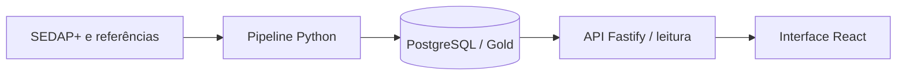

# Arquitetura da aplicação

A aplicação é um monorepo com dois pacotes: `frontend` (React/Vite) e `backend` (Fastify). O backend é um monólito modular: os módulos compartilham o mesmo processo e banco, mas cada um possui suas rotas, consultas e contratos. A pipeline Python tem repositório e execução independentes.



## Execução

Em desenvolvimento, `pnpm dev` inicia Fastify na porta 3000 e Vite na 5173. O navegador usa caminhos relativos; o Vite encaminha `/api`, `/health` e `/docs` ao backend. Em `pnpm build` seguido de `pnpm start`, o Fastify serve também os arquivos compilados do React. `NODE_ENV=production` desativa o Swagger.

`pnpm dev:demo` prepara um PostgreSQL separado na porta 55433, carrega as fixtures e inicia os dois pacotes usando um login de leitura. Cada execução recria a Gold sintética desse container. O comando não altera o `.env` nem prepara o banco da pipeline.

## Limites de responsabilidade

- A pipeline extrai, transforma e grava dados; a API não executa essas etapas.
- A API valida os parâmetros, agrega medidas em SQL e calcula taxas sobre os totais.
- O frontend consulta HTTP/JSON e formata os resultados. Não importa código do backend, não acessa o PostgreSQL e não recalcula taxas.
- Cada módulo do backend expõe um `index.ts`. A composição da aplicação usa essas entradas; módulos não importam arquivos internos uns dos outros.
- `plugins/` reúne acesso compartilhado à Gold, saúde e contratos de erro. `config/` valida o ambiente. O pool e seu encerramento são coordenados em `server.ts`.

## Organização do backend

```text
backend/src/
  modules/
    catalogos/       Opções disponíveis para filtros
    indicadores/    Resumo, agregações e taxas
  plugins/
    gold.ts         Junções da Gold e tratamento de falhas de consulta
    health.ts       Verificação de acesso às tabelas utilizadas
    erros.ts        Schema público de erro
  config/
    index.ts        Leitura e validação de variáveis de ambiente
  app.ts            Composição dos plugins e tratamento HTTP de erros
  frontend.ts       Serviço de arquivos estáticos e navegação da SPA
  server.ts         Pool, inicialização e encerramento do processo
```

O fragmento SQL em `plugins/gold.ts` define as junções comuns com a fato e as seis dimensões consumidas. Os módulos continuam responsáveis por suas seleções, filtros e agregações. Alterações nesse fragmento afetam catálogo, resumo e saúde e devem passar pelos testes de integração.

## Evolução prevista

O futuro módulo `analises` concentrará evolução temporal e comparações entre cursos e grupos institucionais. A Gold atual não fornece nomes ou siglas de IES nem identificadores institucionais permanentes para comparação individual. Administração do ETL depende de um contrato externo para execuções e reprocessamentos. Autorização e monitoramento serão recursos transversais; ainda não estão implementados. Pastas vazias desses módulos não são criadas antecipadamente.

## Documentação relacionada

- [Módulos e contratos do backend](MODULOS_BACKEND.md)
- [Execução, permissões e fórmulas](../backend/README.md)
- [Comandos do monorepo](../README.md)
- [Branches, commits e revisões](../CONTRIBUTING.md)
