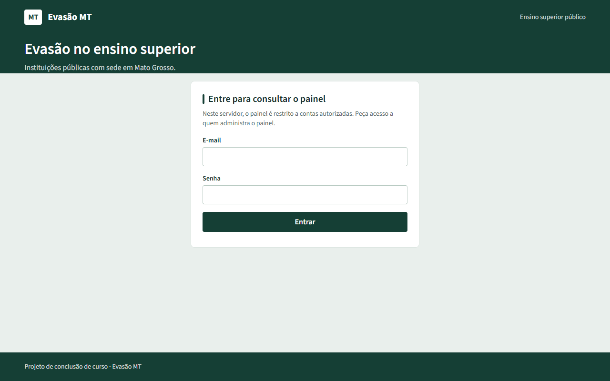

# Login e sessão no painel

O painel é público por padrão: login não é necessário para consultar indicadores e análises. O login identifica quem poderá usar a administração do ETL, que ainda não tem telas. Quando o servidor restringe o painel (`PAINEL_PUBLICO=false`), o login passa a ser exigido antes das abas, como descrito abaixo. Contrato HTTP, sessões e permissões estão em [acesso ao painel e à administração](../arquitetura/AUTORIZACAO.md).

## Painel restrito

Ao abrir, a interface consulta `GET /api/v1/configuracao`. Com `painel_restrito: false`, nada muda. Com `true`, as abas e o botão **Entrar** do cabeçalho somem e a tela de acesso ocupa o conteúdo:

| Estado        | Tela                                                                          |
| ------------- | ----------------------------------------------------------------------------- |
| Verificando   | "Verificando acesso…", enquanto a configuração e a sessão são lidas           |
| Sem sessão    | "Entre para consultar o painel", com o formulário de login e o foco no e-mail |
| Sem permissão | "Conta sem acesso ao painel", com o e-mail da conta e **Sair**                |
| Falha         | "Não foi possível verificar o acesso", com **Tentar novamente**               |

Com sessão e `painel:consultar`, as abas aparecem. A verificação de permissão na tela só evita mostrar um painel vazio; quem nega é o servidor (`403`).

As consultas passam a levar o Bearer da sessão. Num `401`, `consultar` renova a sessão uma vez e repete a consulta; se a renovação também falhar (sessão expirada, revogada ou conta desativada), a sessão é encerrada e a tela de acesso volta com "Sua sessão terminou. Entre novamente para continuar.". A URL é preservada, então o recorte volta depois do login. O CSV usa os dados já carregados e não muda.

## Controles no cabeçalho

| Situação    | Cabeçalho                                                                                              |
| ----------- | ------------------------------------------------------------------------------------------------------ |
| Sem sessão  | Botão **Entrar**                                                                                       |
| Com sessão  | E-mail (a partir de 992 px), **Alterar senha** (**Senha** no celular, mesmo nome acessível) e **Sair** |
| Verificando | Nada, enquanto a sessão é restaurada ao abrir a página                                                 |

Os botões do cabeçalho são nativos, com borda clara sobre a faixa verde, para não herdar as cores do tema do `Button`. Com autenticação desabilitada no servidor, o botão **Entrar** continua visível e o login responde com a mensagem de login não habilitado.

## Gavetas de login e de alteração de senha

As duas gavetas usam o `Sidebar`, como a gaveta de filtros, e o hook `usePaginaInerte`: a página fica inerte enquanto a gaveta está aberta e o foco volta ao botão que a abriu. Ao abrir, o foco vai para o primeiro campo (**E-mail** ou **Senha atual**). Esc e a máscara fecham a gaveta.

Erros aparecem num parágrafo com `role="alert"`, ligado aos campos por `aria-describedby`; os campos com erro recebem `aria-invalid`. Senhas digitadas não sobrevivem ao fechamento: o login limpa a senha, e a alteração de senha desmonta o formulário.

**Login.** Em caso de falha, a senha é apagada e o foco volta ao e-mail. A mensagem depende do status da resposta:

| Status       | Mensagem resumida                                    |
| ------------ | ---------------------------------------------------- |
| sem resposta | Sem conexão com o servidor                           |
| `400`        | Informe um e-mail válido e a senha                   |
| `401`        | E-mail ou senha incorretos, sem indicar qual falhou  |
| `403`        | Login indisponível neste endereço (origem diferente) |
| `404`        | Login administrativo não habilitado neste servidor   |
| `429`        | Muitas tentativas; aguardar um minuto                |
| outros       | Não foi possível entrar agora                        |

**Alteração de senha.** O formulário pede a senha atual, a nova e a confirmação. Antes de enviar, confere de 8 a 64 caracteres, nova senha diferente da atual e confirmação idêntica, levando o foco ao campo a corrigir. Essa conferência evita gastar as cinco tentativas por minuto da rota. Os caracteres são contados como no servidor: um emoji vale um caractere, e não duas unidades UTF-16 como em `length`. O formulário indica quando a nova senha ultrapassa o limite, inclusive ao colar um texto longo.

Senha atual incorreta (`422`) limpa e foca **Senha atual**, preservando a nova senha digitada. Em caso de sucesso, os campos são limpos e uma mensagem informa que as outras sessões da conta foram encerradas. Abas deste navegador continuam conectadas, porque compartilham a mesma sessão.

## Sessão no navegador

- O JWT de acesso fica apenas em memória. O token de renovação fica no cookie `HttpOnly`, inacessível ao JavaScript.
- Ao abrir a página, a sessão é restaurada por `/renovar` uma única vez, mesmo com o efeito duplo do `StrictMode`.
- `localStorage` guarda somente uma marca de que há sessão a restaurar, sem dado sensível. Sem ela, visitas anônimas não chamam `/renovar`. Com storage bloqueado, a sessão apenas não é restaurada ao recarregar.
- O servidor revoga a sessão quando um cookie de renovação já consumido é reutilizado. Por isso as renovações nunca correm juntas: na mesma aba, chamadas simultâneas compartilham uma única renovação; entre abas, a Web Locks API as enfileira, e cada aba envia o cookie já rotacionado pela anterior.
- Entrada e saída são avisadas às outras abas por `BroadcastChannel`; renovações não, para não dispará-las em cascata.
- `tokenAcesso()` devolve um JWT válido, renovando-o a menos de um minuto da expiração, para as futuras rotas administrativas.

Exibir ou ocultar controles não concede acesso: o servidor confere sessão e permissões em cada chamada protegida.

## Organização do código

| Arquivo (`src/modules/autenticacao/`) | Responsabilidade                                                         |
| ------------------------------------- | ------------------------------------------------------------------------ |
| `api.ts`                              | Chamadas HTTP com `X-CSRF-Protection` e, quando há sessão, Bearer        |
| `sessao.ts`                           | Estado da sessão, restauração, renovação serializada e avisos entre abas |
| `regras.ts`                           | Funções puras: renovação antecipada, mensagens e validação da senha      |
| `useSessao.ts`                        | Hook com o usuário atual e o fim da restauração                          |
| `usePaginaInerte.ts`                  | Página inerte e foco devolvido nas gavetas                               |
| `AcessoAdministrativo.tsx`            | Botões do cabeçalho e gaveta de login                                    |
| `AlterarSenha.tsx`                    | Gaveta de alteração de senha                                             |

`index.ts` expõe `AcessoAdministrativo`, `useSessao`, `tokenAcesso` e o tipo `Usuario`. `test/autenticacao.test.ts` cobre as funções de `regras.ts`.

## Validação

Em 25/11/2026, com `pnpm dev:demo:auth` no navegador do aplicativo (Chromium):

- visita anônima sem `/renovar`; login com senha errada e correta; sessão restaurada ao recarregar com uma única renovação;
- duas abas recarregadas ao mesmo tempo sem revogar a sessão; logout e login propagados entre abas;
- `403` ao acessar por `localhost` com a origem configurada para `127.0.0.1`;
- foco inicial, foco devolvido ao entrar, sair e fechar, `inert` e `aria-invalid`; cabeçalho em 320 px sem rolagem lateral;
- alteração de senha: validação local sem requisição, `422`, sucesso, sessão de outro dispositivo recusada e senha antiga recusada.

Não foram verificados leitor de tela real, Firefox, Safari, dados reais nem implantação atrás de HTTPS.
